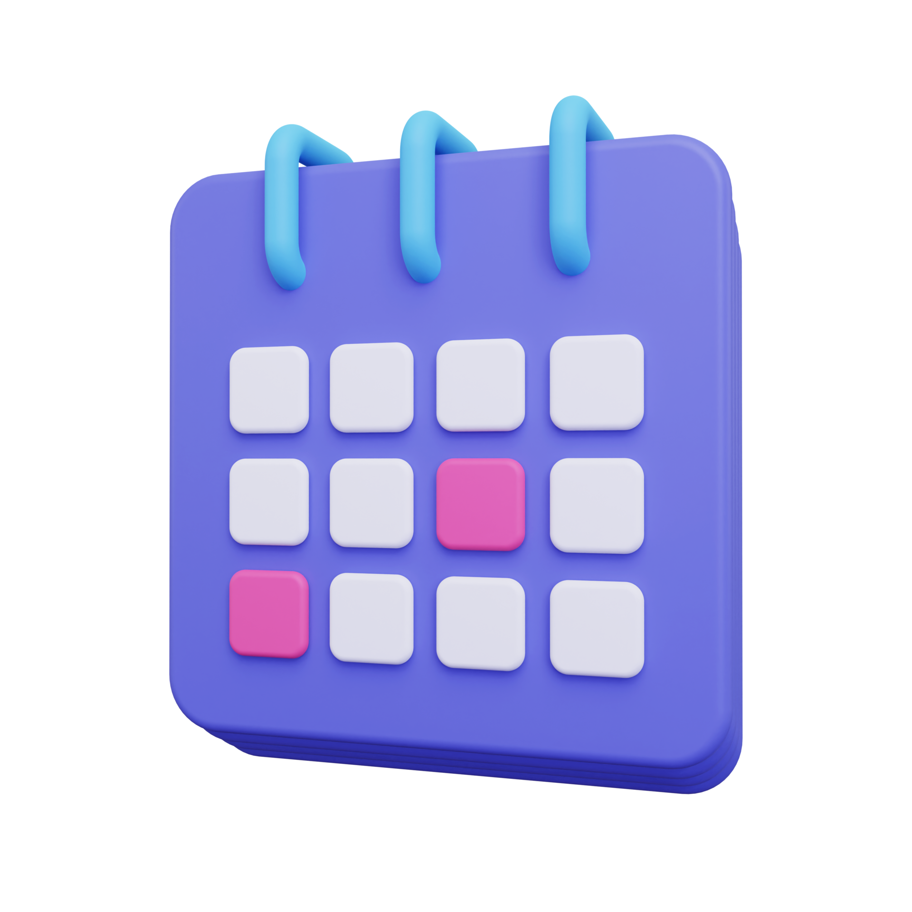
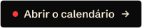
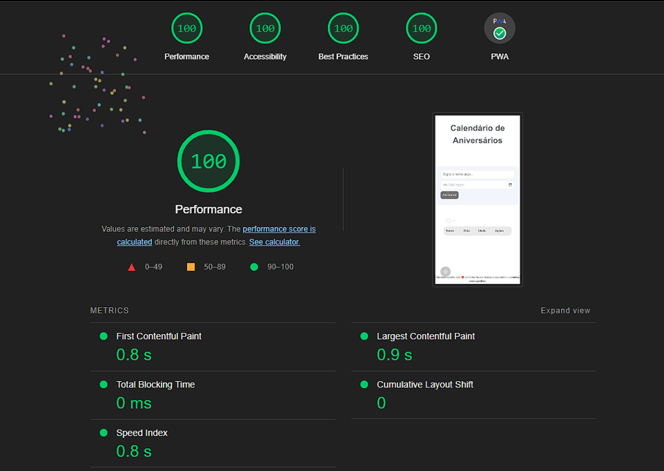

<a id="top"></a>

<div align="center">



<h1>Calendário de Aniversários</h1>

<p>
  <strong>Guarde os aniversários de quem é importante para você e edite ou remova cada um quando quiser.</strong><br />
  <sub>CRUD em HTML, CSS e JavaScript, com dados salvos no navegador</sub>
</p>

<p>
  <a href="https://voaneves.github.io/calendario-de-aniversarios/"><picture><source media="(prefers-color-scheme: dark)" srcset="https://raw.githubusercontent.com/voaneves/calendario-de-aniversarios/main/assets/buttons/live-dark.svg" /></picture></a>
  <a href="#como-usar"><picture><source media="(prefers-color-scheme: dark)" srcset="https://raw.githubusercontent.com/voaneves/calendario-de-aniversarios/main/assets/buttons/use-dark.svg" /></picture></a>
</p>

<p><sub>Precisa de algo assim? <a href="https://voaneves.com/#contato"><strong>Vamos conversar →</strong></a></sub></p>

<p>
  <a href="https://github.com/voaneves/calendario-de-aniversarios/blob/main/LICENSE"></a>
  
</p>

<p>
  <a href="https://voaneves.github.io/calendario-de-aniversarios/">Demo</a> ·
  <a href="#funcionalidades">Funcionalidades</a> ·
  <a href="#como-usar">Como usar</a> ·
  <a href="#estrutura">Estrutura</a> ·
  <a href="#contato">Contato</a>
</p>

</div>

<picture>
  <source media="(prefers-color-scheme: dark)" srcset="https://raw.githubusercontent.com/voaneves/calendario-de-aniversarios/main/assets/brand/rule-dark.svg" />
  <source media="(prefers-color-scheme: light)" srcset="https://raw.githubusercontent.com/voaneves/calendario-de-aniversarios/main/assets/brand/rule-light.svg" />
  
</picture>

## Sobre o projeto

Um calendário no navegador para guardar os aniversários de quem é importante para você, com formulário para adicionar, editar e remover cada data.

<p align="center">
  <a href="https://voaneves.github.io/calendario-de-aniversarios/">
    
  </a>
</p>

Projeto feito para praticar o módulo de Desenvolvimento Web do Bootcamp Programador de Software (XP Educação), no curso de Sistemas de Informação.

**Demo:** <https://voaneves.github.io/calendario-de-aniversarios/>

### Tecnologias

HTML, CSS e JavaScript puros, sem dependências. A página funciona em vários navegadores e plataformas, com a pontuação de Lighthouse abaixo.

<p align="center">
  
</p>

## Funcionalidades

- Adicionar aniversários ao calendário por um formulário.
- Exibir os aniversários em uma tabela abaixo do formulário.
- Editar e remover aniversários existentes.
- Botão para ordenar por data de aniversário.
- Tema claro e escuro, com cores baseadas no Google Bard.
- A tabela é gerida em JSON e salva no `localStorage`.
- Ícones do icomoon.

## Estrutura

- `index.html`: estrutura do calendário e elementos interativos.
- `style/style.css`: estilo visual.
- `script/script.js`: lógica de interação.
- `fonts/theme.woff2`: fonte de ícones icomoon.

## Como usar

1. Clone o repositório:

   ```bash
   git clone https://github.com/voaneves/calendario-de-aniversarios.git
   ```

2. Abra o `index.html` em um navegador.
3. Preencha o nome e a data de nascimento e clique em "Adicionar".
4. Cada aniversário da tabela tem opções para editar e remover.
5. Troque o tema pelo botão de alternância no canto superior esquerdo.

## To do

- [x] Adicionar modal/tutorial para quem entrar no site
- [x] Adicionar ordenação para o array JSON dos aniversários
- [x] Com a ordenação ligada, manter a edição igual entre `aniversarios` e `aniversariosSorted`
- [ ] Adicionar notificações para lembrete dos aniversários
- [x] Transformar em webapp
- [x] Melhorar a estrutura da página, adicionar tags `<meta>` e otimizar a entrega do JavaScript

## Reportando bugs

Encontrou um problema? Veja se ele já foi relatado nas [issues](https://github.com/voaneves/calendario-de-aniversarios/issues). Se não, abra uma nova issue com um título claro, os passos para reproduzir e, se possível, capturas de tela. Pull requests também são bem-vindos.

## Contato

<p>
  <a href="https://voaneves.com/#contato"><picture><source media="(prefers-color-scheme: dark)" srcset="https://raw.githubusercontent.com/voaneves/calendario-de-aniversarios/main/assets/buttons/hire-dark.svg" /></picture></a>
  <a href="https://voaneves.com/"><picture><source media="(prefers-color-scheme: dark)" srcset="https://raw.githubusercontent.com/voaneves/calendario-de-aniversarios/main/assets/buttons/site-dark.svg" /></picture></a>
</p>

<a href="https://linkedin.com/in/voaneves">LinkedIn</a> · <a href="mailto:victorneves478@gmail.com">E-mail</a>

<p align="center">
  
</p>

<p align="center"><sub>Distribuído sob a <a href="https://github.com/voaneves/calendario-de-aniversarios/blob/main/LICENSE">licença MIT</a>.</sub></p>

<p align="center"><sub><a href="#top">↑ Voltar ao topo</a></sub></p>
