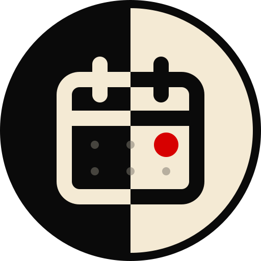
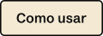
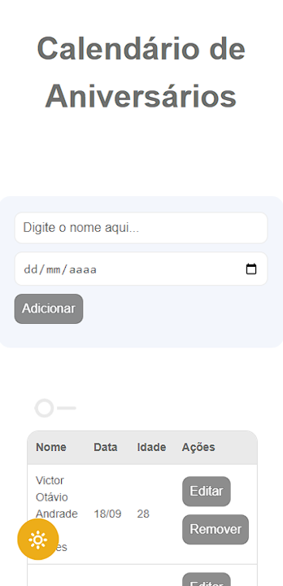
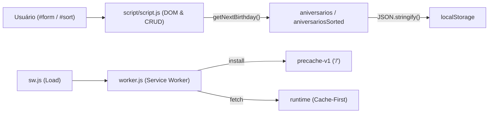

<a id="top"></a>

<div align="center">

<picture>
  <source media="(prefers-color-scheme: dark)" srcset="https://raw.githubusercontent.com/voaneves/calendario-de-aniversarios/main/assets/logo/logo-dark.svg" />
  <source media="(prefers-color-scheme: light)" srcset="https://raw.githubusercontent.com/voaneves/calendario-de-aniversarios/main/assets/logo/logo-light.svg" />
  
</picture>

<h1>Calendário de Aniversários</h1>

<p>
  <strong>Guarde, edite e ordene aniversários direto no navegador com persistência local, tema claro/escuro e suporte offline via PWA.</strong><br />
  <sub>
    CRUD em HTML, CSS/SCSS e JavaScript puro com nota máxima no Lighthouse —
    <kbd>HTML5</kbd> · <kbd>SCSS</kbd> · <kbd>JavaScript</kbd> · <kbd>localStorage</kbd> · <kbd>PWA</kbd>
  </sub>
</p>

<p>
  <a href="https://voaneves.github.io/calendario-de-aniversarios/"><picture><source media="(prefers-color-scheme: dark)" srcset="https://raw.githubusercontent.com/voaneves/calendario-de-aniversarios/main/assets/buttons/live-dark.svg" /></picture></a>
  <a href="#como-usar"><picture><source media="(prefers-color-scheme: dark)" srcset="https://raw.githubusercontent.com/voaneves/calendario-de-aniversarios/main/assets/buttons/use-dark.svg" /></picture></a>
</p>

<p><sub>Precisa de algo assim? <a href="https://voaneves.com/#contato"><strong>Vamos conversar →</strong></a></sub></p>

<p>
  <a href="https://github.com/voaneves/calendario-de-aniversarios/blob/main/LICENSE"></a>
  
  
</p>

<p>
  <a href="https://voaneves.github.io/calendario-de-aniversarios/">Demo</a> ·
  <a href="#funcionalidades">Funcionalidades</a> ·
  <a href="#arquitetura">Arquitetura</a> ·
  <a href="#como-usar">Como usar</a> ·
  <a href="#estrutura">Estrutura</a> ·
  <a href="#contato">Contato</a>
</p>

</div>

<picture>
  <source media="(prefers-color-scheme: dark)" srcset="https://raw.githubusercontent.com/voaneves/calendario-de-aniversarios/main/assets/brand/rule-dark.svg" />
  <source media="(prefers-color-scheme: light)" srcset="https://raw.githubusercontent.com/voaneves/calendario-de-aniversarios/main/assets/brand/rule-light.svg" />
  
</picture>

<a id="funcionalidades"></a>
## Sobre o projeto

Gerencie os aniversários de quem importa em uma interface rápida sem backend, com cálculo automático de idade e ordenação pela próxima celebração.

Construído para o módulo de Desenvolvimento Web do Bootcamp Programador de Software da **XP Educação** (Sistemas de Informação). Demonstração ao vivo: <https://voaneves.github.io/calendario-de-aniversarios/>

<p align="center">
  <a href="https://voaneves.github.io/calendario-de-aniversarios/">
    
  </a>
</p>

### CRUD completo e ordenação inteligente

O formulário (`#form`) adiciona aniversários com data UTC, calcula a idade atual via `calcularIdade()` e permite editar ou excluir mantendo `aniversarios` e `aniversariosSorted` sincronizados. O switch `#sort` projeta datas já passadas no ano corrente para o próximo ciclo com `duplicateAndGetNextBirthday()`.

### Tutorial animado e auditoria Lighthouse

<table>
  <tr>
    <td width="50%" align="center" valign="top">
      <br />
      <sub><strong>Modal de boas-vindas</strong> (<code>#modal-one</code>) exibido até a primeira confirmação</sub>
    </td>
    <td width="50%" align="center" valign="top">
      <a href="https://pagespeed.web.dev/analysis/https-voaneves-com-calendario-de-aniversarios/dy2zzoyur6?form_factor=mobile">
        
      </a><br />
      <sub><strong>100</strong> em Performance, Acessibilidade, Boas Práticas, SEO e PWA</sub>
    </td>
  </tr>
</table>

<a id="arquitetura"></a>
## Estado no navegador e cache PWA



<dl>
  <dt><strong>Chaves no <code>localStorage</code></strong></dt>
  <dd><code>aniversarios</code> (ordem original), <code>aniversariosSorted</code> (ordenado pelo próximo aniversário), <code>sorted</code> (estado do switch) e <code>isModalDismissed</code> (controle do tutorial)[^1].</dd>
  <dt><strong>Tema claro/escuro e ícones</strong></dt>
  <dd>Detecta <code>prefers-color-scheme</code> no carregamento e alterna <code>.light-mode</code> / <code>.dark-mode</code> via <code>.theme-toggle</code>, com glifos servidos em <code>fonts/theme.woff2</code>.</dd>
</dl>

<a id="como-usar"></a>
## Como usar e estrutura

> [!TIP]
> Para testar o **Service Worker** (`sw.js` → `worker.js`) e a instalação PWA localmente, sirva a pasta via HTTP em `localhost` (a origem `file://` bloqueia Service Workers).

```bash
git clone https://github.com/voaneves/calendario-de-aniversarios.git
cd calendario-de-aniversarios
python -m http.server 8000
```

<a id="estrutura"></a>
### Arquivos principais

| Caminho | Função |
| :--- | :--- |
| [`index.html`](./index.html) | Marcação semântica, modal `#modal-one`, SEO e scripts deferidos |
| [`script/script.js`](./script/script.js) | Lógica CRUD, `calcularIdade()`, ordenação e alternância de tema |
| [`style/style.scss`](./style/style.scss) | Fonte SCSS compilada para `style/style.css` |
| [`sw.js`](./sw.js) · [`worker.js`](./worker.js) · [`manifest.json`](./manifest.json) | Registro e cache offline do PWA (`standalone`) |

### Roadmap

- [x] Modal tutorial inicial e alternância de tema claro/escuro
- [x] Ordenação e edição sincronizada entre `aniversarios` e `aniversariosSorted`
- [x] PWA instalável e entrega minificada de CSS/JS
- [ ] Notificações programadas para lembrar aniversários

<a id="contato"></a>
## Contato

<p>
  <a href="https://voaneves.com/#contato"><picture><source media="(prefers-color-scheme: dark)" srcset="https://raw.githubusercontent.com/voaneves/calendario-de-aniversarios/main/assets/buttons/hire-dark.svg" /></picture></a>
  <a href="https://voaneves.com/"><picture><source media="(prefers-color-scheme: dark)" srcset="https://raw.githubusercontent.com/voaneves/calendario-de-aniversarios/main/assets/buttons/site-dark.svg" /></picture></a>
</p>

<a href="https://linkedin.com/in/voaneves">LinkedIn</a> · <a href="mailto:victorneves478@gmail.com">E-mail</a>

<p align="center">
  
</p>

<p align="center"><sub>Distribuído sob a <a href="https://github.com/voaneves/calendario-de-aniversarios/blob/main/LICENSE">licença MIT</a> © 2026 <a href="https://github.com/voaneves">Victor Neves</a> · <strong>VOANEVES.</strong></sub></p>

<p align="center"><sub><a href="#top">↑ Voltar ao topo</a></sub></p>

[^1]: Nenhum dado é enviado para servidores externos; todos os aniversários permanecem localmente no dispositivo.
